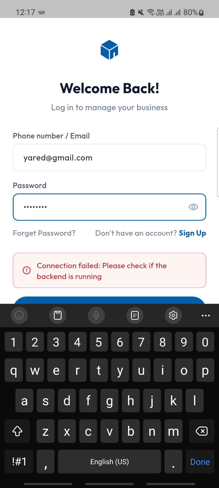
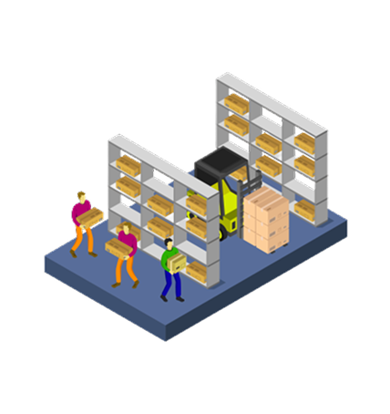

# BM Stock — Project Demo

A quick showcase of the BM Stock / Gelagle Stock platform: a Flutter mobile app
for stock, sales, branch and credit management, backed by a web frontend, admin
portal and API.

The web frontend can also run as a standalone, backend-free portfolio demo with
realistic sample data. See [DEPLOY.md](DEPLOY.md) for the Vercel deployment
steps and demo-mode details.



## What it does

The mobile app covers the day-to-day running of a stock business:

- **Authentication & onboarding** — sign up, verify, app-lock, guided onboarding
- **Dashboard & reports** — sales overview, stock overview, business reports
- **Products & stock** — product list/entry, stock in, stock out, barcode scanning
- **Sales** — new sale, sales history, credit sales, receipts
- **Customers & suppliers** — customer and supplier lists
- **Branches & warehouses** — branch management, warehouse dashboard and product details, transfers
- **Shops** — shop list, shop dashboard, shop product details
- **Finance** — banks, commissions, outstanding credit, payments, purchases, borrowing
- **Team & settings** — staff management, staff access, notifications, settings
- **Subscriptions** — plan selection and additional company requests
- **Localization** — multi-language support via `intl` and custom localizations
- **Push notifications** — Firebase Cloud Messaging

## Tech stack

| Layer | Stack |
| --- | --- |
| Mobile | Flutter, Dart, BLoC/Cubit, Provider, Google Fonts |
| Backend services | Firebase (Core, Messaging), REST API via `http` |
| Web frontend | `apps/bm-stock-frontend` |
| Admin portal | `apps/bm-stock-admin-portal` |
| API | `apps/bm-stock-backend` |
| Version | `1.0.4+7` |

## Screens / assets





## Repository layout

```text
apps/
  bm-stock-flutter-app/    # Mobile client (Flutter)
  bm-stock-frontend/       # Web frontend
  bm-stock-admin-portal/   # Admin portal
  bm-stock-backend/        # Backend / API
archive/
  expo-app/                # Legacy Expo prototype
```

## Run the mobile demo locally

Requires the Flutter SDK (Dart 3) and a device/emulator.

```powershell
cd apps\bm-stock-flutter-app
flutter pub get
flutter run
```

To run against a different backend, update the API base URL in the app's core
services configuration before starting.

---

This demo file intentionally contains no release-signing material — only
project information and screenshots, so it is safe to post or share.
